# texttop

A colorful desktop environment that lives entirely in your terminal — windows,
taskbar, start menu, wallpaper, and a set of built-in apps, rendered with
[ratatui](https://ratatui.rs). Runs on **Windows, Linux, and macOS**. Fully
self-contained: no external programs required — the browser/video engine uses
the platform's built-in webview (WebView2 / WebKitGTK / WKWebView).

```
cargo run --release            # open the desktop
cargo run --release -- <file>  # open the desktop with a file
```

Use a truecolor terminal with mouse support (Windows Terminal, iTerm2,
Terminal.app, GNOME Terminal, Konsole, kitty, alacritty, …) and make the
window big. Set `TEXTTOP_TRUECOLOR=1` or `0` to override the auto-detect.

<!-- screenshots:start -->

## Screenshots

<p align="center">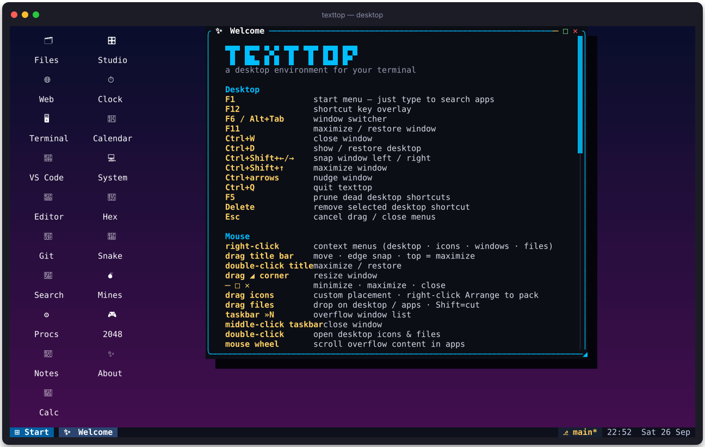</p>

<table>
<tr>
<td width="50%" align="center"><a href="docs/HANDBOOK.md#web">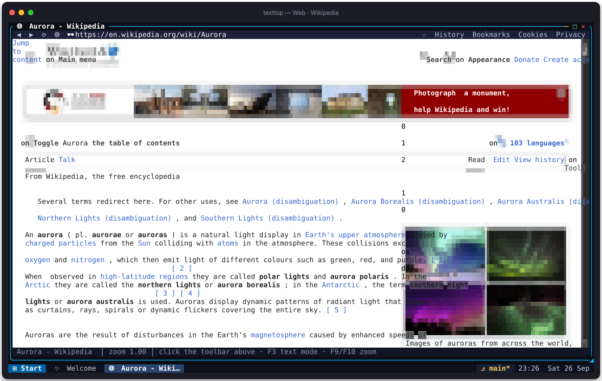</a><br><sub>Web — Wikipedia, text drawn as terminal characters</sub></td>
<td width="50%" align="center"><a href="docs/HANDBOOK.md#windows">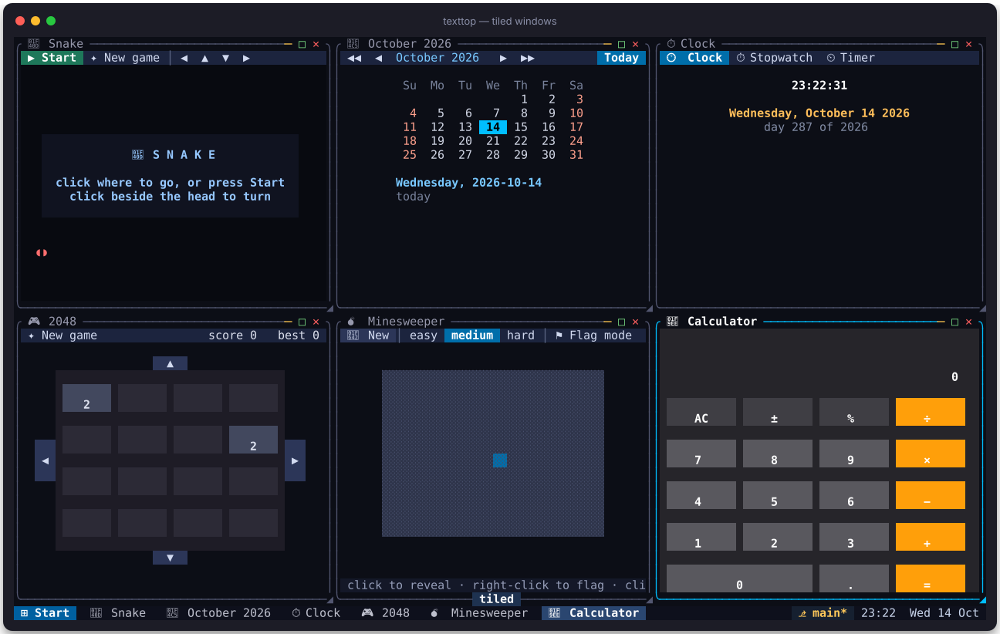</a><br><sub>Tiled windows</sub></td>
</tr>
<tr>
<td width="50%" align="center"><a href="docs/HANDBOOK.md#studio">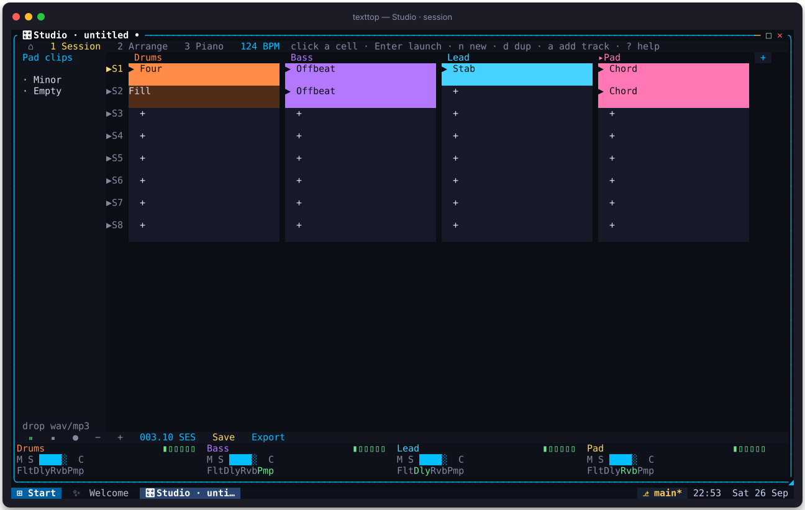</a><br><sub>Studio</sub></td>
<td width="50%" align="center"><a href="docs/HANDBOOK.md#windows">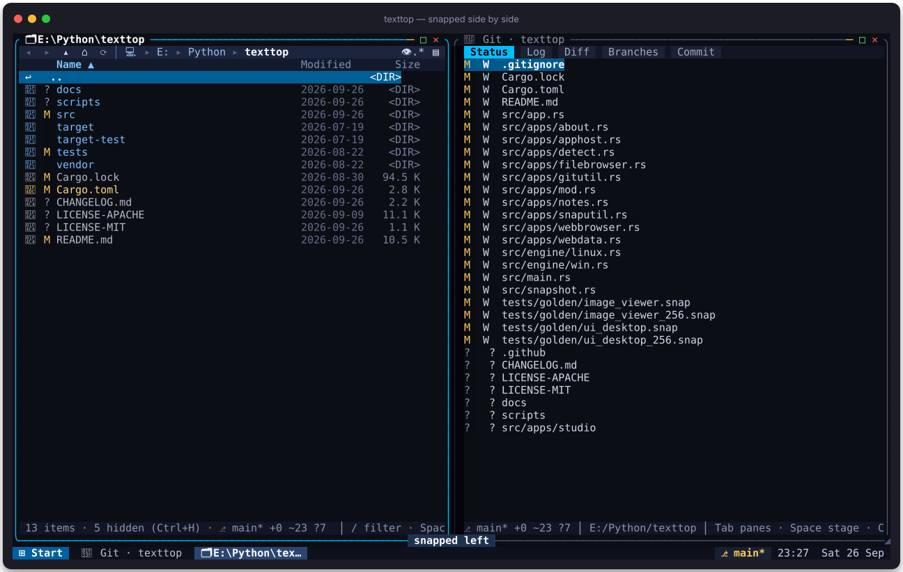</a><br><sub>Snapped side by side</sub></td>
</tr>
<tr>
<td width="50%" align="center"><a href="docs/HANDBOOK.md#files">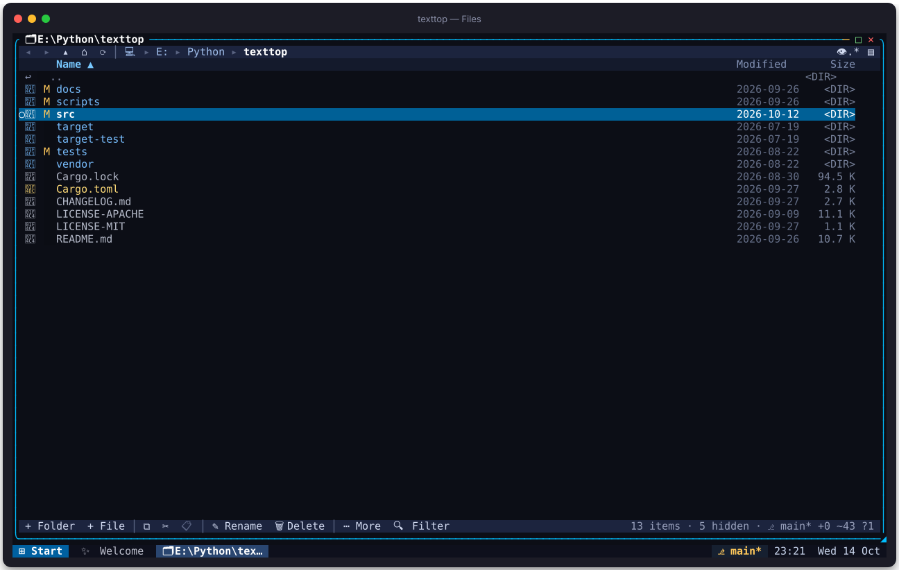</a><br><sub>Files</sub></td>
<td width="50%" align="center"><a href="docs/HANDBOOK.md#images">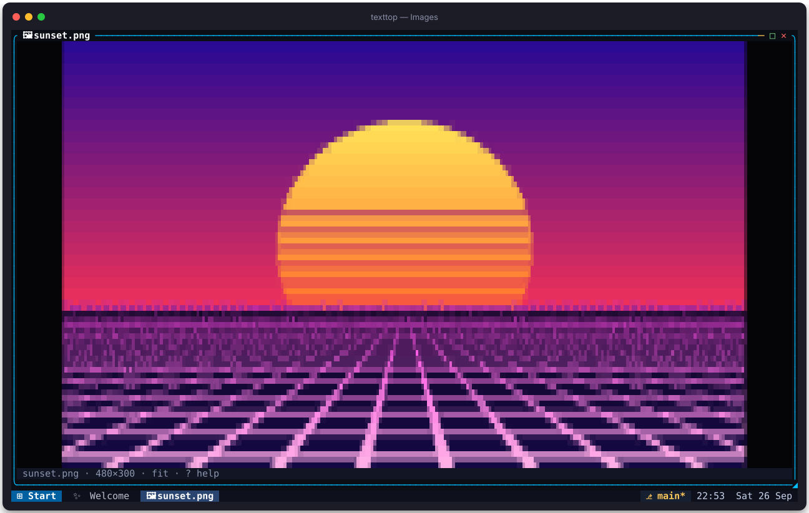</a><br><sub>Images</sub></td>
</tr>
<tr>
<td width="50%" align="center"><a href="docs/HANDBOOK.md#editor">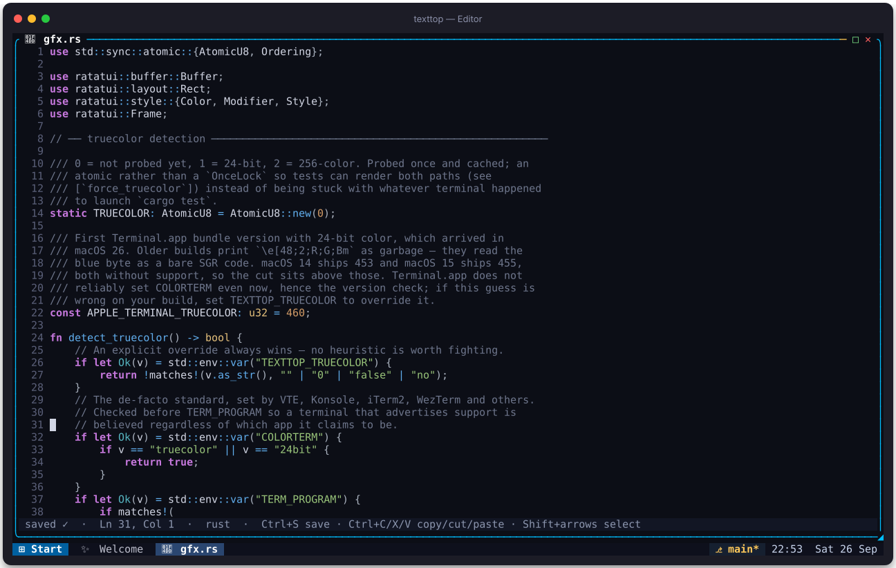</a><br><sub>Editor</sub></td>
<td width="50%" align="center"><a href="docs/HANDBOOK.md#studio">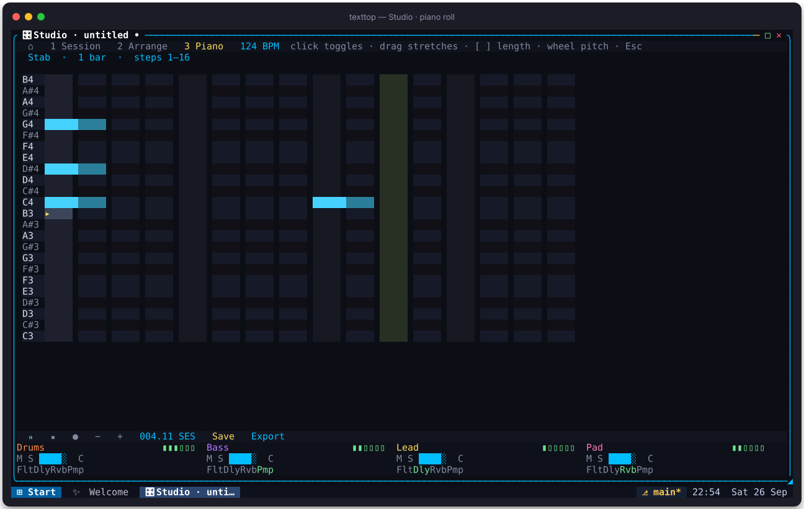</a><br><sub>Piano roll</sub></td>
</tr>
<tr>
<td width="50%" align="center"><a href="docs/HANDBOOK.md#git">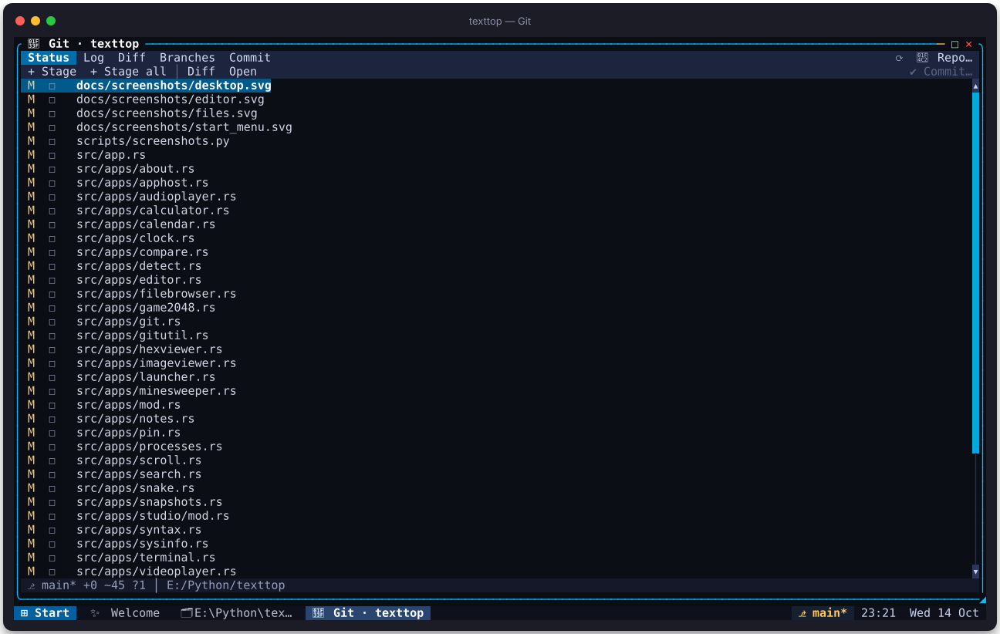</a><br><sub>Git</sub></td>
<td width="50%" align="center"><a href="docs/HANDBOOK.md#terminal">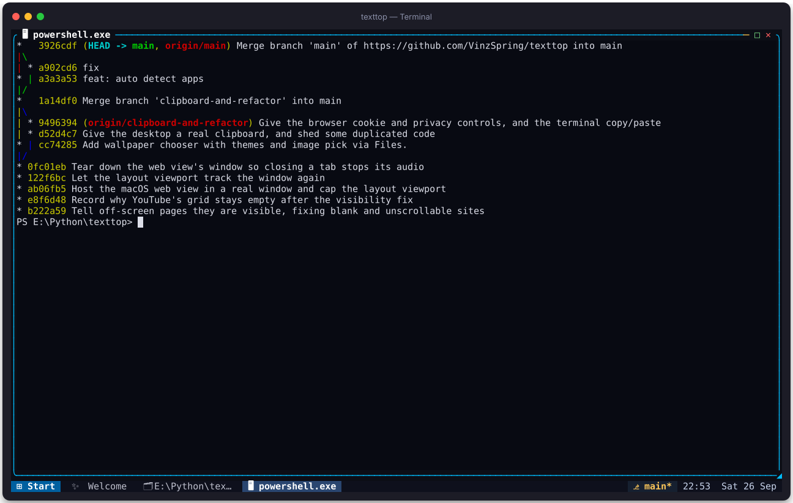</a><br><sub>Terminal</sub></td>
</tr>
<tr>
<td width="50%" align="center"><a href="docs/HANDBOOK.md#tools">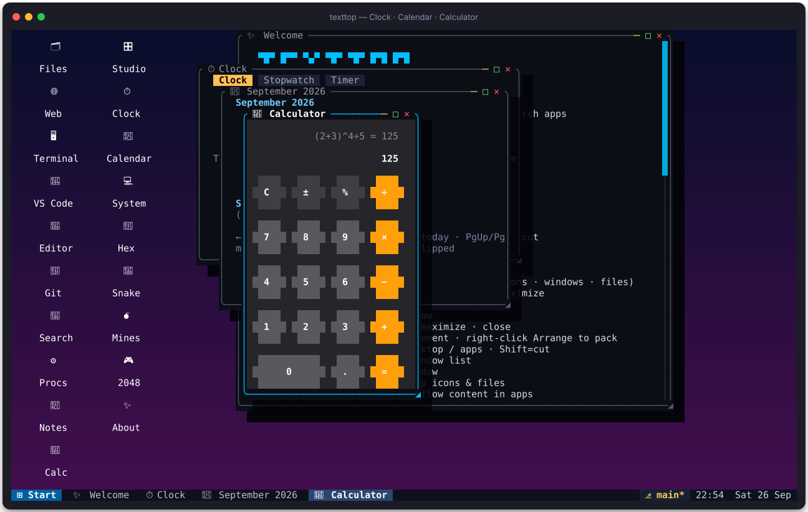</a><br><sub>Clock · Calendar · Calc</sub></td>
<td width="50%" align="center"><a href="docs/HANDBOOK.md#windows">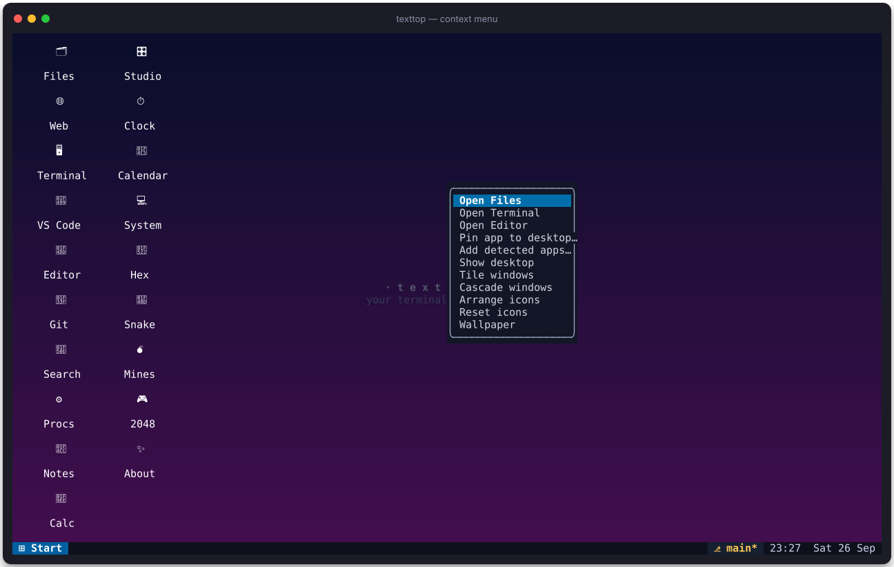</a><br><sub>Context menus</sub></td>
</tr>
</table>

More in the **[handbook](docs/HANDBOOK.md)** — every app, pictured and explained.

<!-- screenshots:end -->

## Building

**Windows** — just `cargo build --release`. WebView2 ships with Windows 10/11.

**macOS** (13+)
```
xcode-select --install          # once, for Swift/WebKit tooling
cargo build --release
```

**Ubuntu / Debian**
```
sudo apt install build-essential pkg-config libasound2-dev libwebkit2gtk-4.1-dev
cargo build --release
```

**Fedora**
```
sudo dnf install gcc pkg-config alsa-lib-devel webkit2gtk4.1-devel
cargo build --release
```

Minimal build without audio / web engine (no system deps at all):
```
cargo build --release --no-default-features
```
The web/video engine needs a graphical session on Linux (X11/Wayland);
on headless boxes use `xvfb-run`.

## Testing

`cargo test` runs the unit tests and the golden render tests
(`UPDATE_SNAPSHOTS=1 cargo test` accepts intended changes to the pictures).

To check that everything builds, renders and works on Linux — from any OS with
Docker:
```
docker build -f tests/linux/Dockerfile -t texttop-linux-test .
docker run --rm -v "$PWD/target/linux-e2e:/out" texttop-linux-test
```
The container builds with every default feature (WebKitGTK, ALSA), runs
`cargo test` under a virtual X server, then drives the real binary in a
pseudo-terminal (`tests/linux/e2e.py`): desktop, Run app here, the IDE app
group, tabs, the directory watcher, a web page through WebKitGTK, the folder
picker, App Groups settings and Contribute's clone. Each step's screen is
saved in `target/linux-e2e`. Add `-e E2E_NO_NETWORK=1` to skip the clone.

## Known limitations

- **Studio** needs the `audio` feature (on by default). Dropped samples are referenced by path (relative to the `.ttstudio` file when they sit beside it), not copied in; keep those wav/mp3 files around.
- **AppHost** (host a real desktop window inside texttop) is Windows-only.
- **macOS Web:** off-screen WKWebView never runs `requestAnimationFrame`, so sites that paint in rAF (YouTube’s video grid among them) stay as empty cards. Windows WebView2 does not have this problem.
- **Web cookie policy on Windows:** WebView2 has no "refuse cookies" switch, so turning cookies off wipes the jar after every page load and every few seconds instead.
- **Linux Web:** headless machines need `xvfb-run`.
- Snapshots live in `~/.texttop_snap/`. Desktop layout is `~/.texttop_desktop.json`.

## Apps

| App | What it does |
|-----|--------------|
| 🗂 Files | Browse drives/folders with filter, rename, delete, mkdir, copy/cut/paste, sort, preview, bookmarks; **git status badges**; **Space multi-select**; snapshots & compare from right-click; Ctrl+G opens Git; F3 hex · F4 edit · Ctrl+T terminal here |
| 🌿 Git | Status / log / diff / branches / commit via system `git` — Space stages, Enter opens files |
| ⏱ Snapshots | Local file history in `~/.texttop_snap` — create, preview, version diffs, restore |
| ↔ Compare | Visual unified diff of 2+ selected files (assign A/B when N>2) |
| 🔎 Search | Project search with `rg` when available, else recursive walk; Enter opens in Editor |
| ⚙ Processes | List / filter / kill OS processes |
| 🌐 Web | **Real graphical browser** (Edge / WebKit): JS, CSS, media — with **hybrid rendering**: pixels for images/layout, and the page's text extracted and drawn as crisp terminal characters (F3 toggles). F4 for URL, click links, type into forms, F9/F10 zoom. F2 bookmark · F7 privacy · F8 cookies |
| 🖥 Terminal | Full shell (`portable-pty` + vt100) inside a desktop window — copy/paste via the system clipboard |
| 🧩 Programs | Run executables / `.app` bundles: terminal, args form, or detached |
| 🪟 Desktop Apps | **Windows:** host a real desktop window inside texttop (pixels mirrored, input forwarded). Start menu → **VS Code** is the same path pointed at `code` |
| 🎵 Audio | Plays mp3/wav/flac/ogg (rodio) with visualizer, seek + volume |
| 🖼 Images | Quadrant-pixel truecolor rendering — zoom, pan, gallery, slideshow; `w` sets wallpaper; `?` help |
| 🎬 Video | Engine-based playback **with sound** — any format the platform webview plays |
| 📝 Editor | Text editor with line numbers and syntax highlighting (Rust, Python, JS/TS, C/C++, Go, Java, JSON, TOML, YAML, HTML, CSS, SQL, Shell, Markdown, …). Ctrl+S saves, Ctrl+H toggles highlight |
| 🧮 Calculator | Expression calculator (`+ − * / ^ %` and parentheses) with history |
| 🎛 Studio | Electronic music studio — genre templates, session clip grid (launch / stop / duplicate), piano roll with note lengths and audition, drag-and-drop arrangement, add / remove tracks, mixer with volume / pan / one-tap FX, save `.ttstudio`, export WAV |
| ⏱ Clock | Live clock, stopwatch, and countdown timer |
| 📅 Calendar | Month calendar — jump by day/week/month/year |
| 📌 Notes | Sticky notepad persisted to `~/.texttop_notes.txt` |
| 🔢 Hex | Hex/ASCII dump viewer (Files → F3) |
| 💻 System | OS/CPU info, special folders, environment snapshot |
| 🐍 Snake | Arrows steer · gets faster as you eat |
| 💣 Minesweeper | Click / flag mines · 3 difficulties |
| 🎮 2048 | Slide & merge tiles to 2048 |
| 🎨 Wallpaper | Chooser for gradient themes (classic + vivid) plus an **image…** tile that opens Files to pick a photo |
| 🧩 Detected Apps | Scan PATH for vim · nvim · claude · gemini · git · python · … and pin chosen ones to the desktop |
| ✨ About | In-app help (also the first-run welcome window) |

## Desktop controls

- **F1** start menu · **F6 / Alt+Tab / Ctrl+Tab** window switcher · **F11** maximize · **F12** shortcut-key overlay
- **Ctrl+W** close · **Ctrl+D** show/restore desktop · **Ctrl+Shift+←/→** snap · **Ctrl+Shift+↑** maximize
- **Ctrl+arrows** nudge window · **Ctrl+Q** quit · **F5** prune dead shortcuts · **Delete** remove selected shortcut · **Esc** cancel drag/menus
- Mouse: drag title bars (edge snap, top edge maximizes), double-click title to maximize,
  drag the `◢` corner to resize, `─ □ ✕` buttons, taskbar buttons to focus/minimize
  (middle-click to close), **»N** overflow menu when windows don't fit
- **Right-click** context menus on the desktop, icons, window title bars, taskbar, and files
- **Drag** desktop icons to place them on the grid (right-click **Arrange icons** to pack them again); **drag files** from Files onto the desktop
  (shortcut), into Files (copy/move), or onto Editor / Hex / Image / Audio / Video / Web / Terminal / Studio
  — hold **Shift** while dragging to cut; **Esc** cancels
- Files → right-click → **Pin to desktop** · **Git: stage / unstage / diff** · **Create snapshot** · **Snapshot history** · **Compare N files**
- Files → **Space** marks files · **Ctrl+A** select all · **Esc** clears · **Ctrl+click** toggles mark
- Files → **Ctrl+G** opens the Git app for the current folder
- Snapshots are stored in `~/.texttop_snap/` (content-addressed blobs + index)
- Taskbar shows **⎇ branch*** when the focused workspace is a git repo — click to open Git
- Pin programs to the desktop or taskbar (name, icon, args template, working dir); Detected Apps and Programs both create pins
- Layout, pins, wallpaper & shortcuts persist in `~/.texttop_desktop.json`; open windows are restored on next start (Exit via the start menu)
- Start menu → Wallpaper opens a chooser (gradient themes; **image…** tile opens Files to pick a photo)
- Press **?** in Files, Git, Images, and Studio for per-app keymaps
- Developer extras need **git** on PATH (and optionally **rg** for faster Search)

## Architecture notes

- `src/engine/` — off-screen webview per platform (WebView2 on Windows,
  WebKitGTK on Linux, WKWebView on macOS) on its own thread; captures
  frames, decodes to RGB, shares them with the TUI. Input is forwarded as
  native mouse messages (Windows) or simulated pointer events (Linux/macOS),
  plus typed text via JavaScript. A periodic in-page script extracts every
  visible word's rect/color/weight (hiding pixel text from captures), and
  the TUI overlays them as real terminal characters — readable text at any
  zoom, while images/video stay graphical.
- `src/gfx.rs` — quadrant-block renderer: each cell carries a 2×2 pixel
  pattern with a best two-color fit (16 glyphs ` ▘▝▀▖▌▞▛▗▚▐▜▄▙▟█`).
- `src/apps/terminal.rs` — PTY via portable-pty, screen state via vt100.
- `src/apps/launcher.rs` — `--help` text parser (options, subcommands) that
  recurses into `prog <sub> --help` when you select a subcommand.
- `src/apps/apphost.rs` — Windows-only host for real desktop windows
  (PrintWindow capture + posted input).
- `src/clipboard.rs` — shared copy/paste used by Terminal and other apps.

License: [MIT](LICENSE-MIT) OR [Apache-2.0](LICENSE-APACHE).
