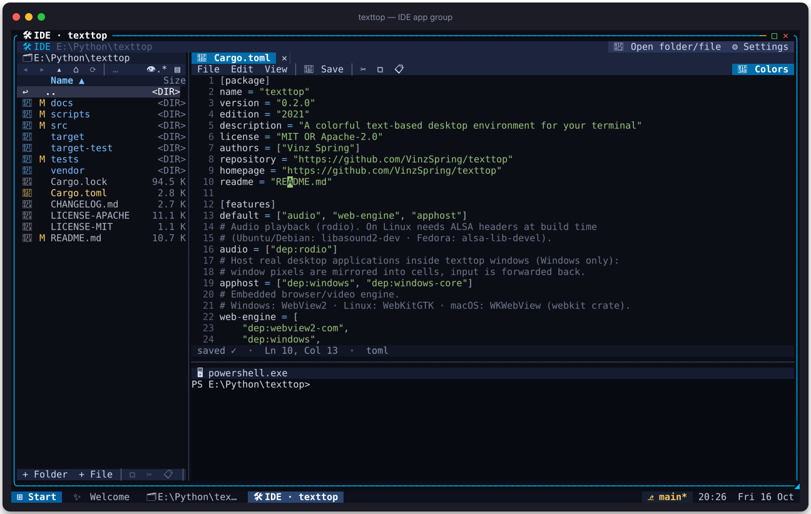

# texttop handbook

_Generated by `scripts/screenshots.py` — re-run it to refresh the pictures._

## Contents

- [The desktop](#desktop)
- [Window management](#windows)
- [Files](#files)
- [Editor](#editor)
- [Git](#git)
- [Terminal](#terminal)
- [IDE, app groups & Contribute](#ide)
- [Images](#images)
- [Studio](#studio)
- [Web](#web)
- [Wallpaper](#wallpaper)
- [Clock, Calendar & Calculator](#tools)
- [Games](#games)

## The desktop

texttop is a windowed desktop that runs in any truecolor terminal with mouse
support. Windows can be dragged by their title bars, resized from the `◢`
corner, snapped to screen edges and maximized. The taskbar shows open windows,
the git branch of the focused workspace, and the clock.

| Keys | Action |
|---|---|
| F1 | start menu |
| F6 · Alt+Tab · Ctrl+Tab | window switcher |
| F11 · Ctrl+Shift+↑ | maximize / restore |
| Ctrl+Shift+← / → | snap left / right |
| Ctrl+W · Ctrl+Q | close window · quit |
| Ctrl+D | show desktop |
| F12 | shortcut overlay |

Right-click anything — desktop, icons, title bars, taskbar, files — for a
context menu. Drag files between windows, onto the desktop (shortcut) or onto
an app to open them there; hold Shift to move instead of copy. Open windows are
restored on the next start.

## Window management

Any number of windows can share the screen.

- **Tile** — right-click the Start button (or the desktop) → *Tile windows*
  lays every open window out in a grid; *Cascade windows* stacks them again.
- **Snap** — drag a title bar against the left or right screen edge, press
  Ctrl+Shift+← / →, or right-click a title bar or taskbar button → *Snap left* /
  *Snap right*. Dragging a snapped window away restores its old size.
- **Maximize** — F11, double-click the title, drag it to the top edge, or □.
- **Switch** — F6, Alt+Tab or Ctrl+Tab opens the switcher; the taskbar shows
  every window (middle-click closes, **»N** lists the ones that don't fit).
- **Menus** — right-click the desktop, icons, title bars, the taskbar and files.
- **F12** shows every desktop shortcut at a glance.

## Files

A full file manager with git status badges, multi-select, previews and
bookmarks. The top bar has back / forward / up / home / refresh, a clickable
path and toggles for hidden files and the preview pane; click a column heading
to sort. The bottom bar holds the everyday actions: **+ Folder**, **+ File**,
copy ⧉ / cut ✂ / paste 📋, **Rename**, **Delete** (with a confirm button),
**⋯ More** and **🔍 Filter**. Click the ○ left of a name to tick several files.
Right-click a file for open-with, hex view, snapshots, compare, pin and git
actions. **Run app here…** lists every built-in app plus your own desktop and
taskbar apps: pick one to start it in the current folder, or to open the
selected files with it (untick **Open selected files** to just use the folder).
The list follows the folder live: files created, renamed or deleted elsewhere
show up on their own.

## Editor

A text editor with line numbers and syntax highlighting for Rust, Python,
JS/TS, C/C++, Go, Java, JSON, TOML, YAML, HTML, CSS, SQL, shell, Markdown and
more. **File** (new, open, save, save as…), **Edit** (cut, copy, paste, select
all) and **View** (syntax colors) menus sit on the top bar next to 💾 Save and
the clipboard buttons; right-click the text for the same edit menu. Drag to
select. Save as… asks for the path in a field with Save / Cancel buttons.

## Git

Status, log, diff, branches and commit through the system `git`. Tabs along
the top switch panes; the second row has the actions for the current pane —
**Stage / Unstage**, **Stage all**, **Diff**, **Open**, **Commit…**,
**Show commit**, **Checkout**, **New branch…**. Tick the box next to a file to
stage it, double-click to open it, right-click for its menu. **📂 Repo…**
switches repository; the commit message is typed into a field with a
✔ Commit button.

## Terminal

Your real shell in a window, with a full VT emulator and system clipboard
copy/paste. Everything you type goes to the shell. Drag to select (copied on
release), right-click for Copy / Paste. When the shell exits, a **Close**
button appears.

## IDE, app groups & Contribute

An **app group** is a virtual app made of several frames: built-in apps docked
left, right, top or bottom around a tab area, all started in one folder. App
groups are listed in the start menu and in **Run app here…** like any other
app, and starting one somewhere hands that folder to every frame.

The **IDE** is the built-in group: a file explorer on the left, a terminal at
the bottom, and everything you open from inside it (a file in the editor, an
image, a video, another terminal) lands in a tab. Its top bar shows the group's
name and folder, **📂 Open folder/file** to move it to another folder or open a
file, and **⚙ Settings**. Drag a frame's edge to resize it.

**🧱 App Groups** (in Settings) edits groups: name, icon, start-menu section,
whether opened apps become tabs, and the list of frames. Each frame has an app,
where it docks, a size, and an optional parameter (a subfolder, a file, or the
command a terminal runs). A sketch shows the arrangement as you go. **▶ Try
it** saves and opens the group.

**🤝 Contribute / Customize** downloads texttop's own source code with git
into texttop's data folder and opens it in the IDE, ready for
`cargo run --release`. **⟳ Get latest** updates the copy later.

## Images

Images are drawn with quadrant pixels: every cell carries a 2×2 pixel pattern
with a best-fit pair of truecolor colors. The toolbar browses the folder
(◀ ▶), zooms (− · Fit · 100% · +), rotates and flips, runs a slideshow, shows
image info and sets the picture as wallpaper. Scroll to zoom at the pointer,
drag to pan, double-click to toggle fit / 100%.

## Studio

An electronic music studio: pick a genre template, launch clips in the session
grid, edit notes in the piano roll, lay out a song in the arrangement and
export a WAV. Drop mp3/wav/flac/ogg files onto the window to use samples.

The header switches between **Session**, **Arrange** and **Piano** and shows
buttons for whatever is selected: **Launch**, **Stop clip**, **New clip**,
**Duplicate**, **Clear**, **Scene**, **+ Track**, **Mute**, **🗑 Track** in the
session; **Place clip**, **Shorter / Longer**, **Remove** in the arrangement;
note length, octave and loop in the piano roll. The transport row plays, stops,
records, changes tempo, saves and exports.

**Session** — click a clip to launch it (again stops), click ▶S*n* to launch a
scene. Click a browser preset to arm it, then click empty cells to fill them.

**Piano roll** — click toggles a note, drag stretches it, the wheel scrolls
pitch.

**Arrangement** — click a lane to place the selected clip, drag to move,
right-click removes. Playback loops the song.

**Mixer** — click M / S, click or scroll the volume bar, scroll a track name
to pan, click Flt · Dly · Rvb · Pmp to toggle effects (scroll Flt for cutoff).

## Web

A real browser engine (WebView2 / WebKitGTK / WKWebView) rendered with hybrid
graphics: images and layout as pixels, text as crisp terminal characters. The
first picture is Wikipedia as you see it; the second is the same page with the
text overlay switched off — the raw pixel frame the engine captures, where
small text would be unreadable. Links, forms, scrolling and video work.

The toolbar has back / forward / reload, the address bar (click to type),
☆ bookmark, History, Bookmarks, Cookies and Privacy. The status bar toggles
**Aa Crisp text** and zooms (− / +).

## Wallpaper

Gradient themes for the desktop background — click a tile to try it — or any
picture via **🖼 Image…** (or **🖼 Wallpaper** in the image viewer).

## Clock, Calendar & Calculator

| App | How |
|---|---|
| Clock | tabs for clock / stopwatch / timer · big Start / Pause and Reset buttons · timer presets and ±1m / ±30s |
| Calendar | ◀◀ ◀ ▶ ▶▶ step months and years · click a day · Today · the wheel flips months |
| Calculator | click the keys or type an expression (`+ − * / ^ %`, parentheses) |

## Games

| Game | How |
|---|---|
| Snake | Start / Pause and New game on the toolbar · click beside the head (or ◀ ▲ ▼ ▶) to turn |
| Minesweeper | click reveals · right-click flags · **⚑ Flag mode** makes clicks plant flags · easy / medium / hard |
| 2048 | swipe the board with the mouse or click the arrows around it · New game |
