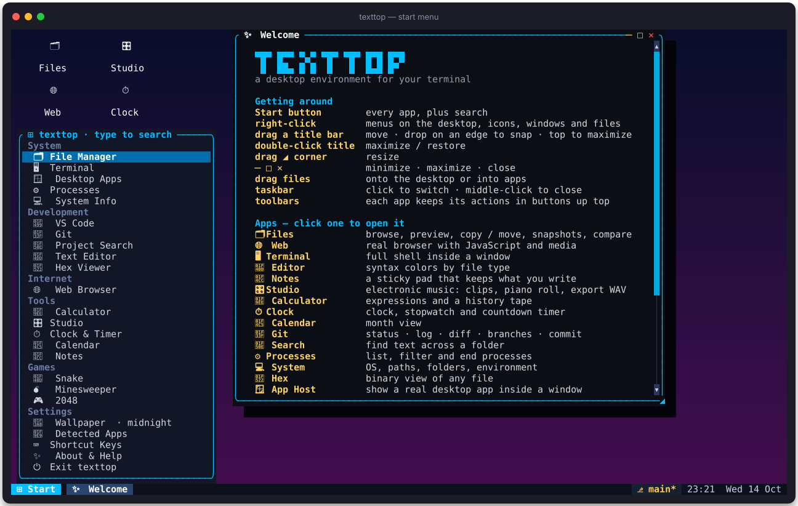
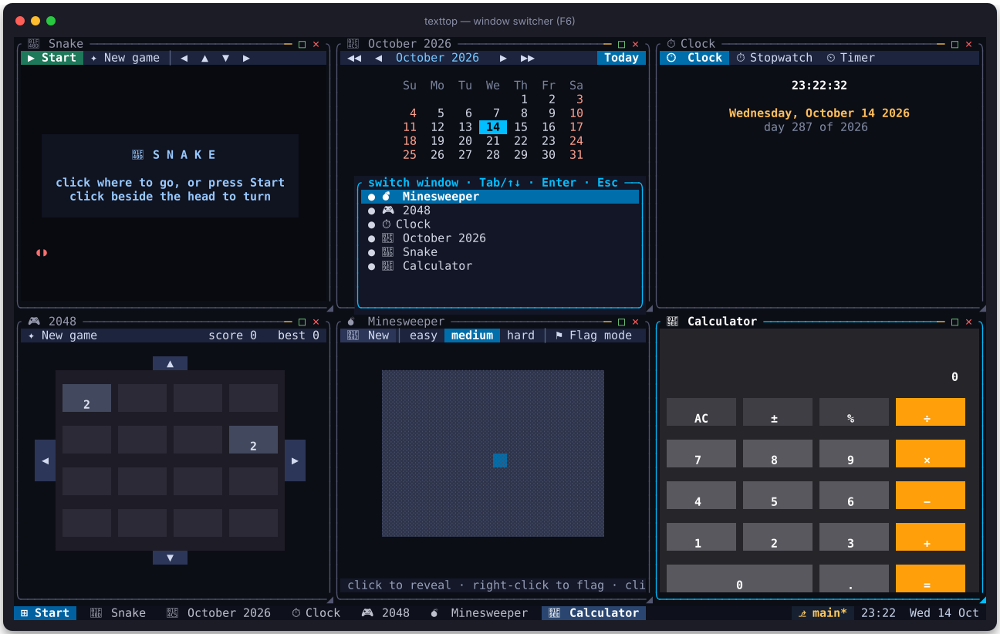
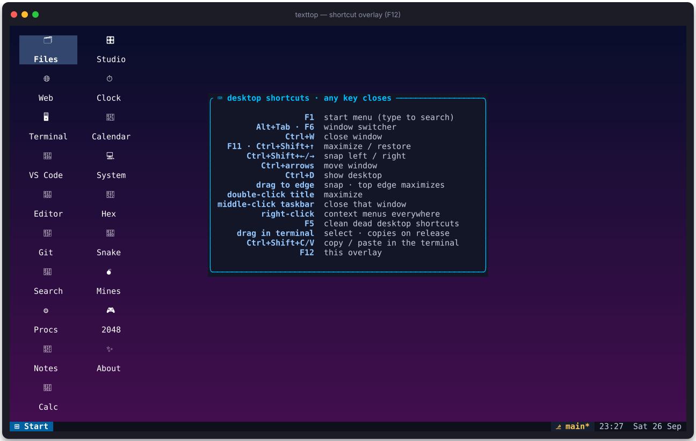
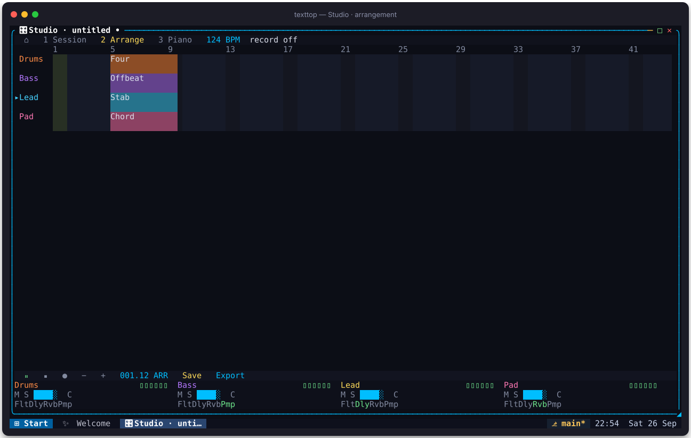
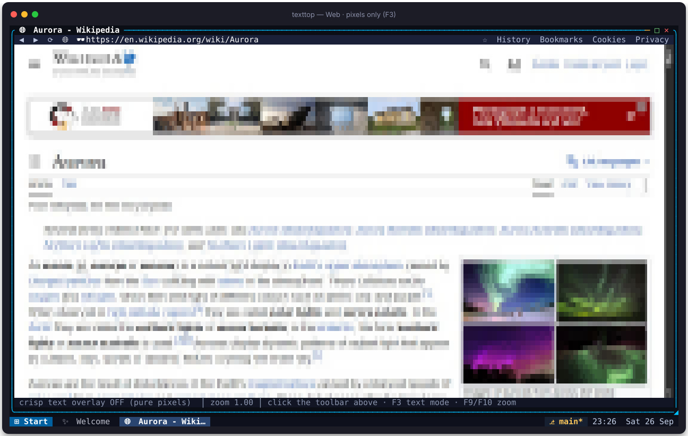
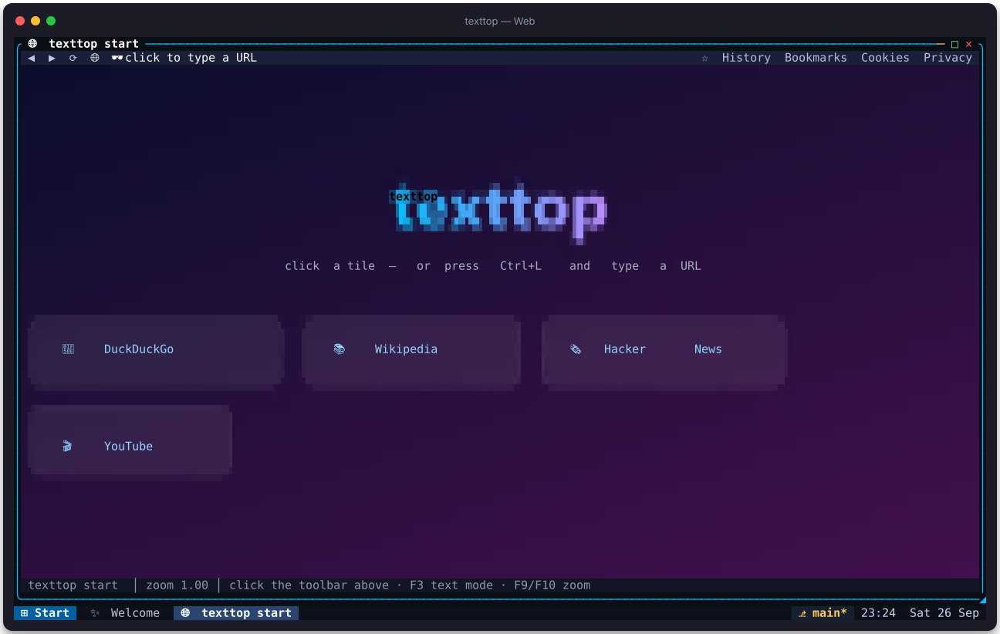
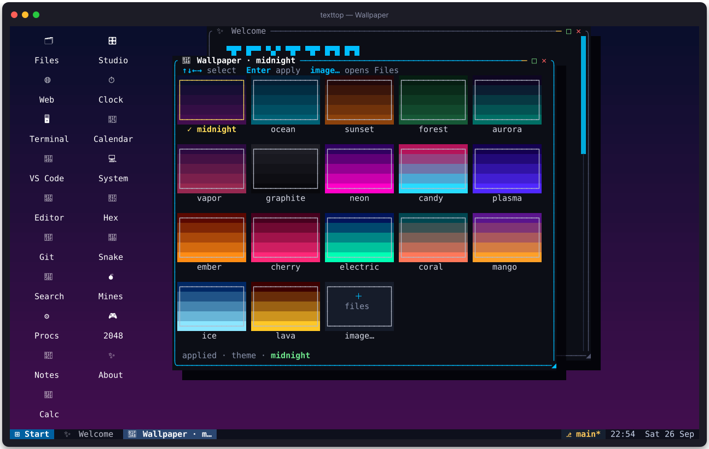
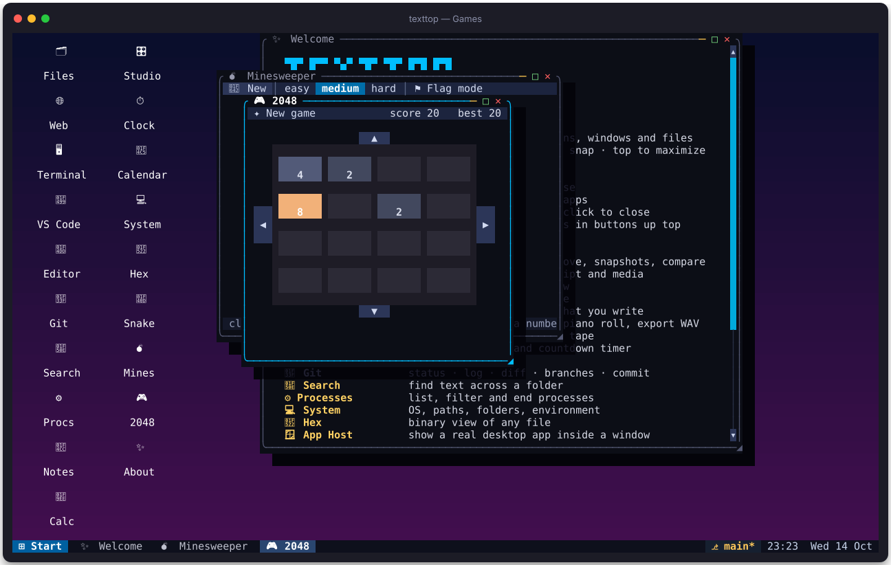

# texttop handbook

_Generated by `scripts/screenshots.py` — re-run it to refresh the pictures._

## Contents

- [The desktop](#desktop)
- [Window management](#windows)
- [Files](#files)
- [Editor](#editor)
- [Git](#git)
- [Terminal](#terminal)
- [Images](#images)
- [Studio](#studio)
- [Web](#web)
- [Wallpaper](#wallpaper)
- [Clock, Calendar & Calculator](#tools)
- [Games](#games)

## The desktop

texttop is a windowed desktop that runs in any truecolor terminal with mouse
support. Windows can be dragged by their title bars, resized from the `◢`
corner, snapped to screen edges and maximized. The taskbar shows open windows,
the git branch of the focused workspace, and the clock.

| Keys | Action |
|---|---|
| F1 | start menu |
| F6 · Alt+Tab · Ctrl+Tab | window switcher |
| F11 · Ctrl+Shift+↑ | maximize / restore |
| Ctrl+Shift+← / → | snap left / right |
| Ctrl+W · Ctrl+Q | close window · quit |
| Ctrl+D | show desktop |
| F12 | shortcut overlay |

Right-click anything — desktop, icons, title bars, taskbar, files — for a
context menu. Drag files between windows, onto the desktop (shortcut) or onto
an app to open them there; hold Shift to move instead of copy. Open windows are
restored on the next start.

## Window management

Any number of windows can share the screen.

- **Tile** — right-click the Start button (or the desktop) → *Tile windows*
  lays every open window out in a grid; *Cascade windows* stacks them again.
- **Snap** — drag a title bar against the left or right screen edge, press
  Ctrl+Shift+← / →, or right-click a title bar or taskbar button → *Snap left* /
  *Snap right*. Dragging a snapped window away restores its old size.
- **Maximize** — F11, double-click the title, drag it to the top edge, or □.
- **Switch** — F6, Alt+Tab or Ctrl+Tab opens the switcher; the taskbar shows
  every window (middle-click closes, **»N** lists the ones that don't fit).
- **Menus** — right-click the desktop, icons, title bars, the taskbar and files.
- **F12** shows every desktop shortcut at a glance.

## Files

A full file manager with git status badges, multi-select, previews and
bookmarks. Right-click a file for snapshots, compare and git actions.

| Keys | Action |
|---|---|
| Enter / → · ← / Backspace | open · up a level |
| Space · Ctrl+A | mark · mark all |
| / or Ctrl+F | filter names |
| Ctrl+L | go to path (or just paste one) |
| Ctrl+C / X / V | copy / cut / paste |
| F2 · Del | rename · delete |
| F3 · F4 | hex view · edit |
| F7 · F8 | new folder · new file |
| Ctrl+P · Ctrl+H | preview pane · hidden files |
| Ctrl+T · Ctrl+G | terminal here · git here |
| ? | full keymap |

## Editor

A text editor with line numbers and syntax highlighting for Rust, Python,
JS/TS, C/C++, Go, Java, JSON, TOML, YAML, HTML, CSS, SQL, shell, Markdown and
more.

| Keys | Action |
|---|---|
| Ctrl+S | save |
| Ctrl+C / X / V | copy / cut / paste (line when nothing is selected) |
| Ctrl+A | select all |
| Ctrl+H | toggle highlighting |
| Shift+arrows | select |

## Git

Status, log, diff, branches and commit through the system `git`.

| Keys | Action |
|---|---|
| Tab / 1–5 | switch panes |
| Space | stage / unstage |
| d · Enter | diff · open file |
| c | commit staged |
| n | new branch |
| Ctrl+L | change repository |

## Terminal

Your real shell in a window, with a full VT emulator and system clipboard
copy/paste. Everything you type goes to the shell; use the mouse or the
desktop keys (F-keys) to manage the window.

## Images

Images are drawn with quadrant pixels: every cell carries a 2×2 pixel pattern
with a best-fit pair of truecolor colors.

| Keys | Action |
|---|---|
| + / − · f · 1 | zoom · fit · actual size |
| arrows / hjkl | pan |
| n / p · ← / → | next / previous in folder |
| Space | slideshow |
| w | set as wallpaper |
| i · ? | info · help |

## Studio

An electronic music studio: pick a genre template, launch clips in the session
grid, edit notes in the piano roll, lay out a song in the arrangement and
export a WAV. Drop mp3/wav/flac/ogg files onto the window to use samples.

**Everywhere**

| Keys | Action |
|---|---|
| Space · Home | play / pause · stop |
| 1 · 2 · 3 · Tab | session · arrange · piano · cycle |
| T | templates |
| R | record launched clips into the arrangement |
| + / − | tempo |
| A · X | add track · delete track |
| S · E | save `.ttstudio` · export WAV |

**Session** — arrows move, Enter launches (again stops), L launches the whole
scene, N new empty clip, D duplicates below, Del clears, `[` `]` volume.
Click a browser preset to arm it, then click empty cells to fill them.

**Piano roll** — click or Enter toggles a note, drag to stretch it, `[` `]`
change its length, the wheel or ↑↓ at the edge scroll pitch, PgUp/PgDn jump an
octave.

**Arrangement** — click a lane to place the selected clip, drag to move,
`[` `]` resize, ←→ nudge, Del or right-click removes. Playback loops the song.

**Mixer** — click M / S, click or scroll the volume bar, scroll a track name
to pan, click Flt · Dly · Rvb · Pmp to toggle effects (scroll Flt for cutoff).

## Web

A real browser engine (WebView2 / WebKitGTK / WKWebView) rendered with hybrid
graphics: images and layout as pixels, text as crisp terminal characters. The
first picture is Wikipedia as you see it; the second is the same page with the
text overlay switched off (F3) — the raw pixel frame the engine captures,
where small text would be unreadable. Links, forms, scrolling and video work.

| Keys | Action |
|---|---|
| F4 | address bar |
| F3 | toggle text overlay |
| F9 / F10 | zoom |
| F2 | bookmark |
| F7 · F8 | privacy · cookies |

## Wallpaper

Gradient themes for the desktop background, or any picture via the
**image…** tile (or `w` in the image viewer).

## Clock, Calendar & Calculator

| App | Keys |
|---|---|
| Clock | Tab cycles clock / stopwatch / timer · Space start/stop · R reset · `[` `]` ±1 min |
| Calendar | ←→ day · ↑↓ week · `[` `]` month · PgUp/PgDn year · T today |
| Calculator | type an expression (`+ − * / ^ %`, parentheses) · Enter evaluates |

## Games

| Game | Keys |
|---|---|
| Snake | arrows / wasd steer · Space pause · r restart |
| Minesweeper | click reveal · right-click flag · 1/2/3 difficulty |
| 2048 | arrows / wasd slide · r restart |
